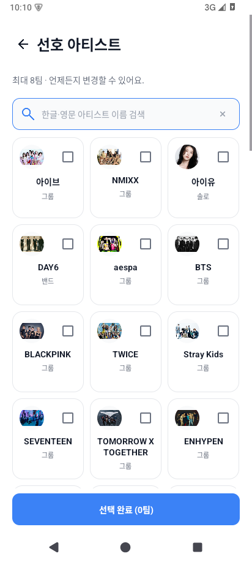

# MyConcert 1.1.0 — 아티스트 프로필 사진

## 구현

- 홈의 선호 아티스트, 검색 목록, 선호 타일, 아티스트 공연 화면과 공연 카드의 이니셜 아이콘에 공통 사진 표시 기능을 적용했습니다.
- 등록 48팀의 **네이버 프로필 카드 이름과 사진 응답**을 확인했습니다. 앱에는 이미지 URL·출처 URL·확인한 이름만 담습니다. [검증 결과](artist-profile-verification.json), [URL 사전](../app/src/main/assets/artist-profiles.json).
- 직접 추가한 아티스트는 공개 네이버 검색 페이지의 프로필 영역을 읽습니다. 이름·별칭을 정확히 비교하고, 새 프로필 형식과 기존 프로필 형식을 모두 지원합니다. 일반 이미지 검색의 첫 결과, 블로그 작성자 사진, 뉴스 썸네일, 관련 인물의 사진을 사용하지 않습니다.
- 그룹에는 출생 정보가 있는 개인 프로필을 적용하지 않으며, 직접 검색한 이름은 음악 활동 정보도 확인합니다. 동명이인 후보가 여러 개면 임의로 선택하지 않습니다.
- 화면에 보이는 아이콘부터 비동기로 불러오고 같은 아티스트의 중복 요청은 합칩니다. 화면이 바뀐 뒤 도착한 응답은 새 아이콘에 잘못 적용하지 않습니다.
- 사진과 프로필 조회 결과는 **메모리에서만 사용**합니다. 이미지 메모리는 최대 8MiB, 조회 정보는 최대 128개입니다. HTTP 디스크 캐시를 사용하지 않으며 이미지 파일을 `filesDir`, `cacheDir`, 외부 저장소에 기록하지 않습니다. 재실행 후 오프라인이면 이니셜로 표시합니다.
- 미등록 아티스트, 이름 불일치, 사진 없음, 네트워크 오류, 페이지 구조 변경, 이미지 해석 실패에서는 기존 이니셜을 유지합니다. 알려진 이미지 주소가 만료되면 프로필 페이지에서 다시 찾습니다.
- 아티스트 화면의 ‘프로필 사진 출처’에서 해당 네이버 프로필 검색 페이지를 열 수 있습니다. 사진의 권리는 원저작자에게 있습니다.

공개 프로필 HTML을 분석하는 기능이며, 별도의 네이버 검색 API 키는 사용하지 않습니다. 외부 서비스의 페이지 구조·이미지 주소가 바뀌면 분석 규칙이나 URL 사전 갱신이 필요할 수 있습니다.

## 검증

2026-11-11 기준:

- 등록 48팀 **48/48**: 이름 일치 및 이미지 응답·해상도 확인. 이미지 데이터는 확인 중 메모리에서 해석한 후 버렸으며 원본 사진 파일은 저장하지 않았습니다.
- 단위 테스트 **46개 통과**. 새 프로필·기존 프로필, 멤버·다른 이름·블로그 사진 제외, 동명이인·외부 주소 거부, 직접 등록 아티스트의 음악 정보, 48팀 URL 포함 여부를 검사했습니다.
- Android 15(API 35)와 Android 9(API 28)에서 **각 16개 기기 테스트 통과**. 기존 선택·삭제·검색·회전·캐시·지도·다크모드·스크롤을 포함합니다.
- 사진 전용 검사 각 2개를 별도로 실행했습니다. 아이브·NMIXX·아이유의 사진이 실제 표시되는지, 사진이 선택 동작을 가리지 않는지, 직접 추가한 ‘터치드’도 사진을 찾는지 확인했습니다. 로딩 전후 앱 내부 파일 목록이 동일한지도 확인했습니다.
- APK 빌드·Lint 오류 0개. 경고 36개는 버전 안내·미사용 자산·화면 구성요소 생성자 및 코드 스타일 제안 등입니다.
- QA용 화면 캡처는 테스트에서만 저장합니다. 앱의 프로필 사진 저장·캐시 기능으로 사용하지 않습니다.

기록: [Android 15 전체](profiles-all-5554.log), [Android 9 전체](profiles-all-5556.log), [사진 전용 Android 15](profiles-photo-5554.log), [사진 전용 Android 9](profiles-photo-5556.log), [빌드](profiles-build.log).



## Git·설치 파일

- 기존 완료본: 태그 `1.0.0v`, Android 1.0.0 / versionCode 5, `output/MyConcert-1.0.0-debug.apk`.
- 사진 적용본: 태그 `1.1.0v`, Android 1.1.0 / versionCode 6, `output/MyConcert-1.1.0-debug.apk`.
- 로컬 Git만 구성했으며 원격 업로드는 하지 않았습니다. API 키·PC 설정·빌드·APK는 Git에서 제외했습니다.

## 재검증

```powershell
./gradlew.bat :app:assembleDebug :app:testDebugUnitTest :app:assembleDebugAndroidTest :app:lintDebug
adb shell am instrument -w -e notClass edu.taehyeon.myconcert.KopisLiveSmokeTest edu.taehyeon.myconcert.test/androidx.test.runner.AndroidJUnitRunner
# 개발 시 프로필 URL만 재조사. 사진 파일을 만들지 않습니다.
python tools/verify-artist-profiles.py
```

조사 도구는 Python의 beautifulsoup4·Pillow를 사용합니다. 앱은 jsoup으로 공개 HTML을 분석하고 Android에서 이미지를 메모리로 해석합니다.
