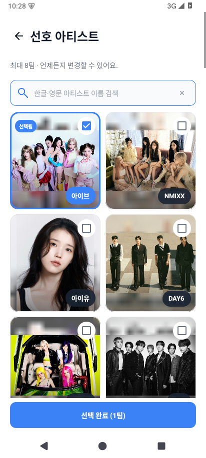
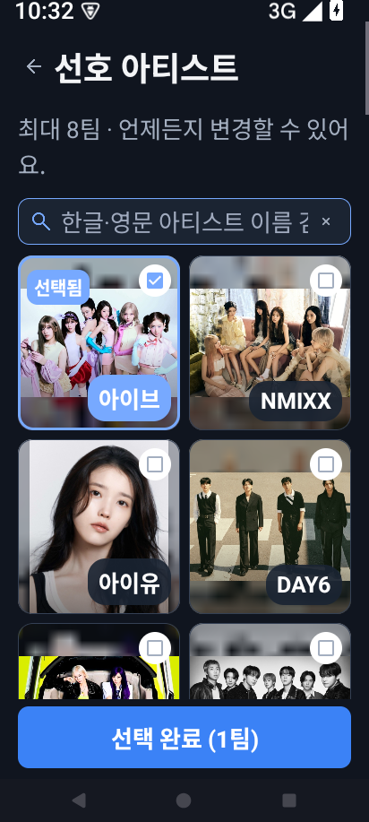

# MyConcert 1.2.0 — 사진 배경 타일과 이름 캡슐

## 변경한 화면

- 첫 실행·선호 아티스트 편집 화면에서 작은 원형 사진과 별도 이름 행을 사진 배경 타일로 교체했습니다.
- 휴대폰에서는 기본 2열로 사진을 크게 보여주고, 넓은 화면에서는 열 수를 늘립니다. 큰 글꼴·좁은 화면은 읽기 가능한 폭을 유지합니다.
- 아티스트 이름을 오른쪽 아래 캡슐에 표시합니다. 긴 이름은 줄바꿈하고 타일 높이를 늘려 전체 이름을 유지합니다.
- 단체 사진은 멤버가 잘리지 않도록 전체 비율을 유지해 표시합니다. 사진 비율 때문에 남는 영역은 같은 사진의 흐린 배경으로 채웁니다. 원본 사진을 가로나 세로로 늘리지 않습니다.
- 타일 크기에 맞춰 512px 원격 사진을 요청하고 메모리에서 해석합니다. 이전 264·342px 아이콘 크기의 사진을 그대로 확대하지 않습니다.
- 오른쪽 위의 체크박스, 선택 테두리, 왼쪽 위 ‘선택됨’, 선택된 이름 캡슐의 색상으로 선택 상태를 구분합니다. 최대 8팀 제한·선택 해제·회전 후 상태 유지도 그대로 동작합니다.
- 사진을 찾지 못하면 타일에 이니셜과 이름을 표시합니다. 사진과 흐린 배경은 메모리에서만 처리하며, 사진 파일이나 HTTP 디스크 캐시를 만들지 않습니다.

## 검증

2026-11-11:

- 단위 테스트 **47개 통과**, APK 빌드·Lint 오류 0개. 경고 38개는 기존 자산·도구 버전·코드 스타일 제안 등입니다.
- Android 15(API 35)·Android 9(API 28)에서 **각 16개 기기 테스트 통과**. 사진 표시, 체크·해제, 검색·삭제, 회전, 저장 응답, 지도·상세 화면, 페이지 확장과 맨 위로 이동을 포함합니다.
- 사진 배경이 타일 전체 크기를 채우는지, 이름 캡슐이 오른쪽·아래 10dp 여백에 놓이는지, 원본 이미지의 가로·세로 확대 비율이 같은지 확인했습니다.
- Android 15 시스템 글꼴 **200%**에서 세로·가로 화면, 긴 이름과 선택 표시를 검사한 뒤 글꼴을 100%로 복원했습니다.
- 로딩 전후 앱 내부 파일 목록이 같음을 확인했습니다. QA용 화면 캡처는 테스트에서만 저장하며 앱의 사진 저장 기능으로 쓰지 않습니다.

기록: [빌드](photo-tiles-build.log), [Android 15 전체](photo-tiles-all-5554.log), [Android 9 전체](photo-tiles-all-5556.log), [200% 글꼴](photo-tiles-font200.log), [사진 Android 15](photo-tiles-photo-5554.log), [사진 Android 9](photo-tiles-photo-5556.log).

## 버전

- `1.0.0v`: 기존 QA 완료본.
- `1.1.0v`: 원격 프로필 사진을 작은 아이콘으로 표시한 버전.
- **`1.2.0v`**: 사진 배경 타일과 이름 캡슐. Android versionName 1.2.0 / versionCode 7.
- 최신 APK: `output/MyConcert-1.2.0-debug.apk`. 기존 선호·직접 등록 정보는 업데이트 설치 시 유지됩니다.
- 로컬 Git으로 관리하며 원격 업로드는 하지 않았습니다.
