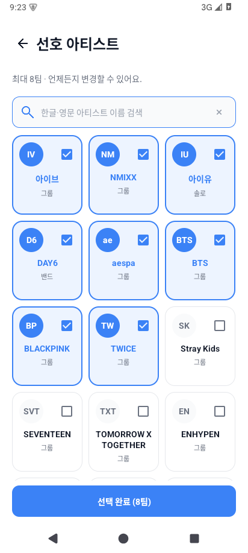
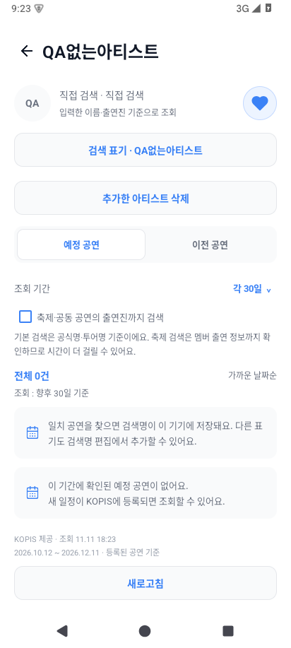
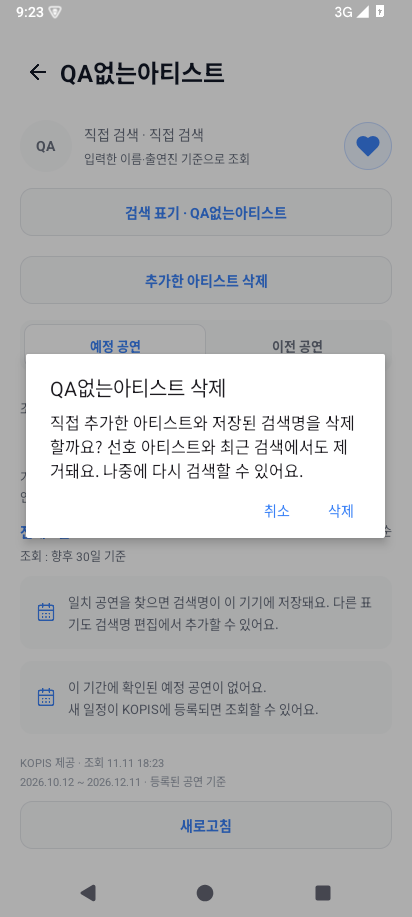
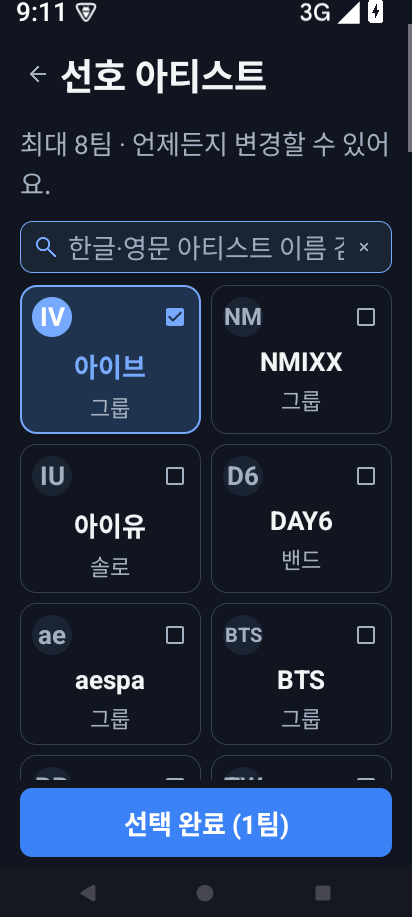
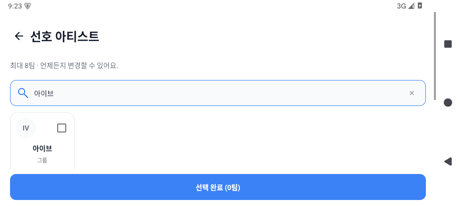
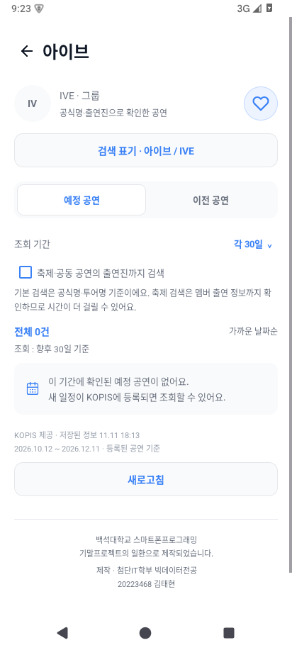

# 3차 QA — MyConcert 1.3.1

## 반영한 요청

- 선호 아티스트 선택은 **체크박스 + 체크 표시 + 파란 배경과 테두리**로 구분합니다. 최대 8팀을 고르는 복수 선택이므로 체크박스를 사용했습니다. 화면 읽기 도구에도 체크 가능 여부와 선택 상태를 전달합니다.
- 첫 실행과 선호 편집 화면에 반응형 타일을 적용했습니다. 412dp 화면은 기본 3열, 글꼴 200%는 2열이며 넓은 화면은 최대 6열입니다. 이름 길이에 따라 행 높이가 늘어나며 이니셜은 원 안에 맞춥니다.
- 아티스트 검색의 **내가 추가한 아티스트**와 직접 검색 결과에 삭제 버튼을 추가했습니다. 미저장 검색도 검색 결과에서 지울 수 있습니다.
- 직접 검색한 아티스트의 공연 화면에도 **추가한 아티스트 삭제**를 표시합니다. 조회 중·오류·결과 0건 여부와 관계없이 사용할 수 있습니다.
- 삭제 전 확인창을 제공하며, 확정하면 검색명·선호·최근 검색을 함께 정리합니다. 삭제된 아티스트로 돌아가는 방문 기록을 제거하고 진행 중 조회의 늦은 응답을 무시합니다. 사전 등록한 기본 아티스트는 삭제하지 않습니다.

## 추가 발견과 결정

전체 현황은 [QA 관리표](QA_ISSUES.md)에 유지합니다. 추가 문제는 재현 결과를 먼저 보고한 뒤 사용자의 결정을 기록합니다.

| ID | 재현된 문제 | 이번 결정 |
|---|---|---|
| QA3-004 | 다크모드 등 아이콘 버튼의 설명이 바깥 버튼과 내부 그림에 중복 등록됨 | 사용자가 함께 수정하도록 승인. 수정·재검증 완료 |
| QA3-005 | 선호 선택 화면에서 ‘아이브’ 입력 → 화면 재생성 → 검색어가 지워짐 | 사용자가 두 항목 모두 수정하도록 승인. 검색어·필터 복원 반영 |
| QA3-006 | 10분 전 응답 파일을 재사용해도 `cached=false`, 표시 시각은 현재 시각으로 반환됨 | 같은 승인 후 정상 캐시·오프라인·메모리 재사용의 출처·시각 표시 수정 |

QA3-005·006은 1.3.1에서 수정했습니다. 수정 전 실패 기록은 [추가 문제 재현 로그](qa3-additional-before.log)에 남겨 두었습니다. `QaAdditionalTest`에는 원래 재현 2개 외에 새로고침으로 실제 요청을 수행하는 경우와 연결 실패 후 캐시를 사용하는 경우를 추가했습니다. 구형 Android의 파일 시각 정밀도 차이를 반영해 실제 파일에 저장된 시각으로 검증합니다.

선호 검색어는 화면 상태에 보관하고 화면 재생성 시 입력과 필터 결과를 복원합니다. 선택 완료 후 다음 편집을 시작할 때는 검색어를 비웁니다. 여러 응답을 합치는 결과는 사용한 응답 중 가장 오래된 저장 시각을 기준으로 표시하며, 화면을 다시 방문해 메모리의 결과를 재사용하는 경우에도 기존 시각을 유지합니다.

## 실행한 검증

- JVM 단위·실제 API 표본 테스트 **40개 통과**.
- 1.3.1에서 Android 15(API 35)·Android 9(API 28)의 **전체 기기 테스트 각각 14개 통과**. 승인된 추가 수정과 새로고침·오프라인 검사도 포함합니다.
- 시스템 글꼴을 실제로 **200%**로 변경한 Android 15에서 세로/가로·다크모드·타일 선택·이니셜과 긴 이름 표시를 검증한 뒤 원래 100%로 복원했습니다.
- 빈 결과·83개 공연·긴 이름은 재현 가능한 테스트 자료로 검증했습니다. 테스트 자료는 앱 APK에 포함되지 않습니다.
- 실제 KOPIS 새 조회: 직접 입력한 **터치드**, 최근·향후 30일. `여전히 소란스럽게 Vol.03 노브레인 with 안예은, 터치드`, 2026-11-13, PF301829 **1건**, 경고 없음. 검색명 저장 후 다시 읽기 확인. [응답 기록](qa3/qa3/live-kopis.json)
- APK 빌드와 Android Lint 통과. 오류 0개, 경고 33개(도구 버전 안내·미사용 자산·코드 스타일 제안 등).

1.3.1 기기 로그: [Android 15](qa3-followup-all-5554.log), [Android 9](qa3-followup-all-5556.log), [추가 수정 Android 15](qa3-followup-5554.log), [추가 수정 Android 9](qa3-followup-5556.log), [실제 KOPIS 조회와 재방문 결과 재사용](qa3-followup-live.log). 실제 조회·저장·메모리 결과 출처·원래 시각 유지 검사 1개도 통과했습니다. 기존 1.3의 [200% 글꼴](qa3-font-tests.log)과 [실제 조회](qa3-live-tests.log) 기록도 보존합니다.

실제 휴대폰의 제조사별 동작과 실제 GPS 수신은 이번 실행 범위에 포함하지 않았습니다.

## 실행 화면













## 재검증

```powershell
./gradlew.bat :app:assembleDebug :app:testDebugUnitTest :app:assembleDebugAndroidTest :app:lintDebug
# 설치 후 전체 기기 검사(실제 외부 API 요청은 별도 선택)
adb shell am instrument -w -e notClass edu.taehyeon.myconcert.KopisLiveSmokeTest edu.taehyeon.myconcert.test/androidx.test.runner.AndroidJUnitRunner
# 추가 수정·새로고침·오프라인 표시만 검사
adb shell am instrument -w -e class edu.taehyeon.myconcert.QaAdditionalTest edu.taehyeon.myconcert.test/androidx.test.runner.AndroidJUnitRunner
# 실제 KOPIS 요청: 명시적으로 선택 실행
adb shell am instrument -w -e class edu.taehyeon.myconcert.KopisLiveSmokeTest -e liveKopis true edu.taehyeon.myconcert.test/androidx.test.runner.AndroidJUnitRunner
```

최신 설치 파일: `output/MyConcert-1.3.1-debug.apk` (versionCode 5). 기존 앱에 업데이트 설치하면 기존 선호·직접 등록 정보가 유지됩니다. 1.3 APK는 변경 이력 확인용으로 남겨 두었습니다.
