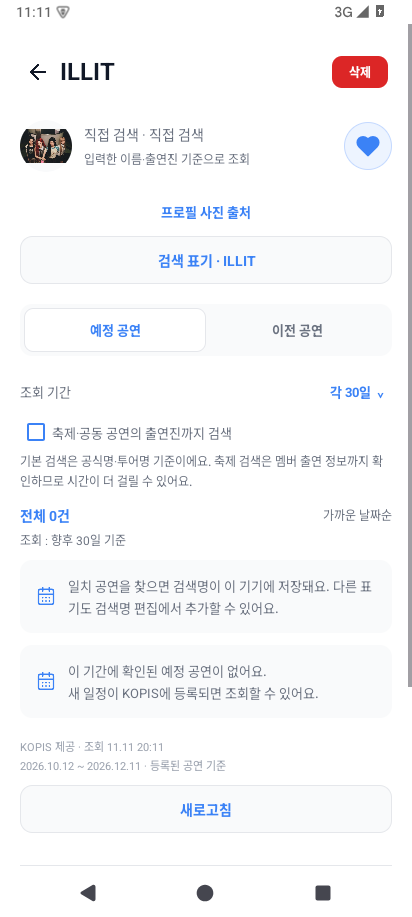
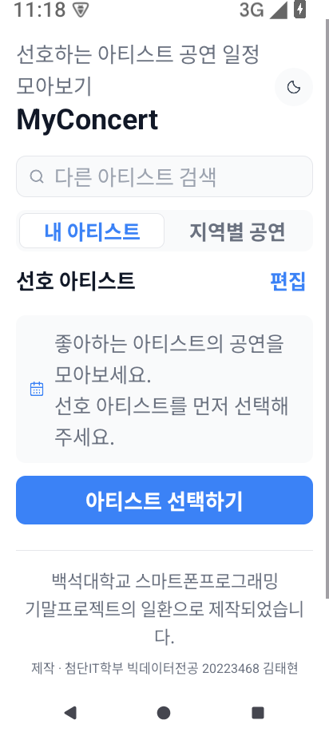
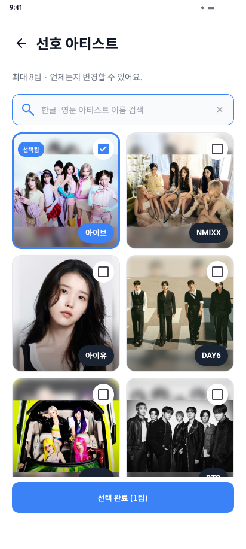

# MyConcert 1.2.1 QA

## 반영한 내용

- **아일릿 프로필:** `ILLIT`로 조회하면 네이버의 한글 제목 ‘아일릿’과 영문 별칭이 나오는 형식을 지원합니다. 새 전체 정보 헤더와 명시적인 다른 이름도 비교합니다. 프로필 탭에 데뷔·앨범·가수 정보가 없으면 전체 정보 페이지에서 음악 직업 정보를 확인합니다. `ILLIT`·`아일릿` 모두 실제 사진을 찾았습니다.
- 이름·별칭은 프로필 제목과 명시적인 별칭 영역에서만 확인합니다. 멤버의 소속그룹 본문에 이름이 들어 있다는 이유로 멤버 사진을 그룹 사진으로 선택하지 않습니다. 동명이인·비음악인·일반 블로그/뉴스 사진 제외 규칙을 유지합니다.
- **삭제 버튼:** 직접 추가한 아티스트의 우측 상단에 빨간 ‘삭제’ 버튼을 표시합니다. 시각 크기 56×32dp, 터치 영역 64×48dp. 본문에 있던 큰 버튼은 제거했습니다. 기존 삭제 확인과 취소, 저장 검색명·선호·최근 검색 정리는 유지합니다.
- **크레딧:** `제작 · 첨단IT학부 빅데이터전공 20223468 김태현`을 한 줄로 표시하고 폭에 맞게 크기를 조정합니다. 그 아래 `github.com/DimTaehyeon ↗` 링크로 [제작자 GitHub](https://github.com/DimTaehyeon)를 엽니다.
- **Figma:** [기존 파일](https://www.figma.com/design/D7NNqJrQzDyFViSuVjaCfX/MyConcert?node-id=2026-1186)의 14개 화면을 갱신하고 아일릿 추가·삭제 흐름 3개를 추가했습니다. 17개 화면에 프로필 사진, 사진 배경 타일, 우측 상단 삭제, 한 줄 제작자 크레딧과 GitHub 링크를 반영했습니다. 전체 UI 스크린샷을 붙이지 않고 텍스트·컴포넌트·아이콘·사진을 편집 가능한 레이어로 구성했습니다.

## 검증

2026-11-11:

- 단위 테스트 **50개 통과**. 새 프로필 헤더·한글/영문 별칭, 앨범 정보가 없는 가수, 비음악인·멤버 오인 제외 재현 3개를 추가했습니다.
- Android 15(API 35)·Android 9(API 28)의 전용 QA 가상 기기에서 **각 18개 통과**. 사용 중인 별도 기기의 앱 데이터는 건드리지 않았습니다.
- 추가 검사: `터치드`·`ILLIT`·`아일릿`의 실제 이미지 표시, 사진 로딩 전후 앱 내부 파일 목록 동일, 아일릿 선택 타일·상세 사진, 작은 우측 상단 삭제 위치, 원래의 큰 삭제 버튼 부재, 한 줄 크레딧과 클릭 가능한 GitHub 링크.
- 시스템 글꼴 200%에서도 제작자 크레딧이 줄바꿈·말줄임 없이 한 줄임을 확인하고 100%로 복원했습니다.
- 빌드·Lint 오류 0개, 경고 38개(기존 자산·도구 버전·스타일 제안 등).
- Figma 17개 화면의 레이어 유형·콘텐츠 이미지 크기·Roboto/Noto Sans KR 폰트·한 줄 크레딧·GitHub 링크를 확인하고 앱 캡처와 비교했습니다. 선택 수, 고정 버튼 위치, 상세 구역 간격과 검색 아이콘을 보정했습니다.

기록: [빌드](qa121-build.log), [Android 15](qa121-all-5558.log), [Android 9](qa121-all-5556.log), [200% 크레딧](qa121-font200-footer.log), [Figma 화면](figma-v1.2.1.json), [Figma 작업 레이어 이력](figma-v1.2.1-state.json).

## 저장소·설치

- [DimTaehyeon/MyConcert](https://github.com/DimTaehyeon/MyConcert), 사용자 선택에 따라 **비공개**로 생성.
- `main`과 `1.0.0v`·`1.1.0v`·`1.2.0v`·`1.2.1v` 태그로 버전 관리.
- 최신 APK: `output/MyConcert-1.2.1-debug.apk` (versionCode 8). API 키가 포함된 APK는 GitHub에 올리지 않고 로컬 설치 파일로만 제공합니다.
- `local.properties`·빌드 결과·APK는 Git에서 제외했습니다. 다른 환경에서 빌드할 때는 `local.properties.example`을 참고해 본인의 SDK 경로와 KOPIS API 키를 설정합니다.
