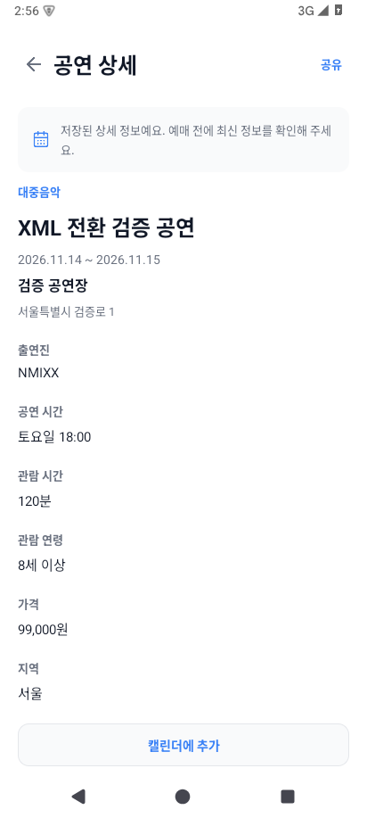
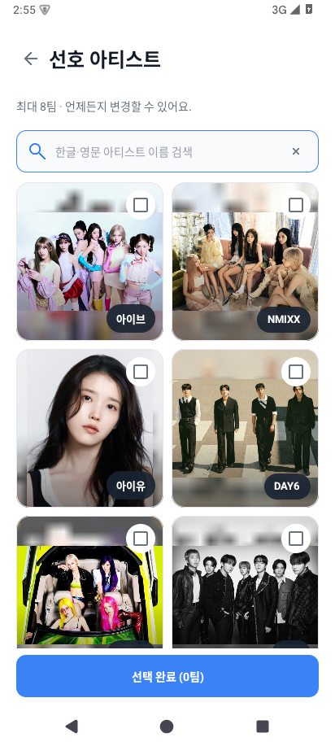
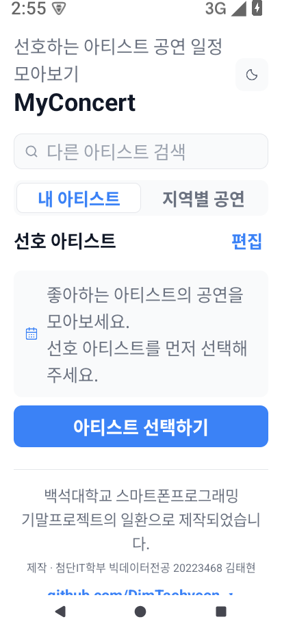

# MyConcert 1.3.0 QA

## 반영 내용

- 화면별 XML과 반복 UI를 `app/src/main/res/layout`의 **39개 파일**로 분리했습니다. 화면 목록과 담당 동작은 [XML 구조 안내](XML_LAYOUTS.md)에 있습니다.
- `MainActivity`는 XML을 불러와 데이터를 연결하고 검색·선호 변경·화면 이동·외부 앱 연결을 처리합니다. 공통 색상·선택 상태·글꼴·배경은 `values`, `values-night`, `color`, `drawable` 리소스로 옮겼습니다.
- 공연 상세의 저장 안내 아래에 **12dp** 여백을 추가했습니다. 타이틀과 기간 사이 여백과 같습니다. 최신 상세에서는 안내와 여백이 함께 숨겨집니다.
- 지역과 캘린더 사이의 ‘공연명에 공식 아티스트명 일치’ 안내박스를 제거했습니다. 검색 결과를 판별하는 매칭 데이터와 규칙은 유지합니다.
- [Figma 저장 상세 화면](https://www.figma.com/design/D7NNqJrQzDyFViSuVjaCfX/MyConcert?node-id=2056-785)에 반영했습니다. 기존 상세 화면을 수정하고 저장 상태를 추가해 총 18개 화면입니다. 안내 컴포넌트·폰트·간격 변수를 재사용했으며 전체 화면 이미지를 붙이지 않고 편집 가능한 레이어로 구성했습니다. [Figma 검증 기록](figma-v1.3.0.json)

## 검증 결과

2026-11-14~15, 최종 설치 파일 기준:

| 항목 | 결과 |
|---|---|
| 단위 테스트 | **50개 통과**, 실패·오류·건너뜀 0개 |
| Android 15 / API 35 | 회귀 **23개 통과** + 별도 실제 KOPIS 연동 **1개 통과** |
| Android 9 / API 28 | 회귀 **23개 통과** + 별도 실제 KOPIS 연동 **1개 통과** |
| 200% 시스템 글꼴 | 두 Android 버전 각각 **3개 통과**: 다크 타일 가로/세로, 한 줄 크레딧, 상세 간격 |
| 기존 앱 업데이트 | 두 버전에서 1.2.1에 데이터 저장 → 최종 1.3.0 APK 덮어 설치 → 유지 확인, 각 단계 통과 |
| 빌드·Lint | 빌드 성공, Lint 오류 **0개**, 경고 35개 |

일반 실행 로그의 `24 tests`에는 별도 실행을 요구하는 KOPIS 실서버 테스트 1개가 포함되어 건너뜀으로 기록됩니다. 이 테스트는 `liveKopis=true`로 따로 실행해 **두 기기 모두 실제 통과**했습니다. 실서버 검증은 ‘터치드’ 검색, 결과에 따른 검색명 저장, 재방문 시 저장 출처·원래 조회 시각을 확인합니다. 이 회차에는 두 기기 모두 1건을 확인했습니다.

확인한 기존 동작:

- 최초 선택·최대 8팀·선택 해제·한글/영문 필터·회전 후 검색어/체크 복원
- 등록되지 않은 아티스트 직접 검색, 검색명 저장·편집, 추가 아티스트 삭제/취소, 기본 아티스트 보호
- 내 아티스트·아티스트별 목록·지역별 공연·전체 목록·빈 결과·저장 응답의 출처/시각
- 83건 결과의 더 보기, 확장된 카드 다음에 새로고침 유지, 맨 위로 이동
- 프로필 사진 표시·ILLIT/아일릿 직접 조회·사진 파일 미생성·사진 비율 유지·선택 캡슐
- 상세 값과 누락 값의 대체 문구, 최신/저장 안내, 간격의 실제 측정, 매칭 안내 부재
- 공유 내용, 예매 URL과 KOPIS 연결, 캘린더 제목·장소·한국 시간·종료 다음 날 처리: 외부 Intent를 가로채 값 검증
- GitHub 링크와 한 줄 제작자 크레딧, 200% 글꼴에서 말줄임·가로/세로 잘림 없음
- 모든 화면 전환 뒤 상태바·내비게이션 영역 여백 유지

업데이트 검증에는 선호 2팀(기본 아티스트와 직접 추가한 ILLIT), 저장 검색명 `ILLIT / 아일릿`, 최근 검색, 부산 지역, 다크모드, 최초 설정 완료 상태를 사용했습니다. 기존 1.2.1 앱에서 저장한 뒤 앱 데이터를 지우지 않고 최종 APK로 업데이트했습니다.

지도 좌표·지역 코드·API·검색 매칭·응답 캐시·저장 데이터 형식은 변경하지 않았습니다. 실기기 GPS 수신·외부 캘린더 앱마다 다른 표시 결과는 이번 가상 기기 검증 범위에 포함되지 않습니다.

## 전환 중 발견해 보정한 부분

- 타일 이미지 바인딩의 이름 충돌을 바로잡아 실제 아티스트를 연결했습니다. 기존 사진 로딩 테스트로 재검증했습니다.
- 화면마다 공통 루트를 교체하면 시스템 버튼 영역 여백이 사라졌습니다. 공통 XML은 한 번만 설정하고 내부 화면을 교체해 겹침과 하단 터치 문제를 해결했습니다. 화면별 여백과 더 보기 동작을 재검증했습니다.
- XML의 `singleLine`이 가로 스크롤 설정을 덮어써 200% 크레딧 자동 축소가 적용되지 않았습니다. `maxLines=1`과 가로 스크롤 해제로 바꾸고 실제 글자 폭·줄 수·말줄임을 두 Android 버전에서 확인했습니다.
- 기존 페이지 테스트의 고정 날짜가 시간이 지나 과거 공연이 되는 문제는 테스트 표본을 현재 날짜 기준으로 바꿨습니다. 앱 조회 규칙은 변경하지 않았습니다.

## 기록·설치

- [검증 요약](qa130/verification.json), [빌드](qa130-build.log), [Android 15](qa130-android15.log), [Android 9](qa130-android9.log)
- 실제 연동: [Android 15](qa130-live-5558.log), [Android 9](qa130-live-5556.log)
- 200% 글꼴: [Android 15](qa130-font200-5558.log), [Android 9](qa130-font200-5556.log)
- 업데이트: [Android 15 저장](qa130-upgrade-seed-5558.log) / [검증](qa130-upgrade-verify-5558.log), [Android 9 저장](qa130-upgrade-seed-5556.log) / [검증](qa130-upgrade-verify-5556.log)
- 최종 설치 파일: `output/MyConcert-1.3.0-debug.apk`, versionCode **9**. APK·API 키·로컬 설정은 Git에서 제외합니다.

